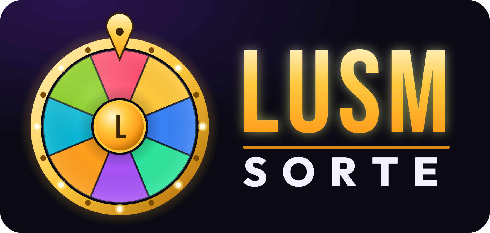

# LUSM - Sorte



Roleta de sorteio honesta, feita em **TypeScript** com **Vite**. Cada nome ocupa uma fatia, quem é sorteado sai da roleta (nunca repete) e o resultado é escolhido por um gerador criptográfico.

## Como rodar

Precisa do [Node.js](https://nodejs.org) 18 ou mais novo.

```bash
npm install
npm run dev       # abre em http://localhost:5173
```

Outros comandos:

```bash
npm run build     # verifica os tipos e gera a versão final em dist/
npm run preview   # serve a pasta dist/ para conferir o build
npm test          # roda os testes de honestidade do sorteio
```

A pasta `dist/` gerada pelo build pode ser publicada em qualquer hospedagem estática (GitHub Pages, Netlify, Vercel…).

## Publicar na Vercel

O projeto já vem configurado (`vercel.json`). Tem dois jeitos:

**Pelo GitHub (recomendado, atualiza sozinho a cada push)**

1. Suba esta pasta para um repositório no GitHub.
2. Entre em [vercel.com/new](https://vercel.com/new), clique em **Import** no repositório.
3. A Vercel detecta tudo sozinha (Vite, `npm run build`, pasta `dist`). É só clicar em **Deploy**.

**Pelo terminal**

```bash
npm i -g vercel
vercel          # primeira vez: faz login e cria o projeto (prévia)
vercel --prod   # publica no endereço oficial
```

## Como o sorteio é honesto

1. Ao clicar em **GIRAR**, o vencedor é escolhido **antes** da animação, com `crypto.getRandomValues` e amostragem por rejeição. Cada nome tem exatamente a mesma chance (1 em N).
2. A roleta calcula quantas voltas dar para parar num ponto aleatório **dentro** da fatia sorteada, longe das bordas, sem empate visual.
3. Ao fechar o resultado, o nome sai da roleta, então ninguém é sorteado duas vezes.
4. Nomes repetidos (mesmo com maiúsculas ou espaços diferentes) não são aceitos.

Os testes em `src/spin.test.ts` confirmam que a roleta sempre para no nome sorteado e que a distribuição é uniforme.

## Estrutura

```
index.html          página
public/             favicon e ícone
brand/              logo (SVG e PNG)
src/
  main.ts           interface: lista, botões, giro, resultado
  wheel.ts          desenho da roleta no canvas
  spin.ts           matemática do giro (sorteio → ângulo final)
  random.ts         aleatoriedade criptográfica e embaralhamento
  audio.ts          sons gerados com Web Audio
  confetti.ts       animação de confete
  storage.ts        salva nomes, resultados e som no navegador
  types.ts          tipos e cores
  style.css         visual
  spin.test.ts      testes
```

## Logo

Em `brand/`:

- `logo.svg` / `logo.png`: logo completa com fundo escuro
- `logo-transparente.svg`: mesma logo sem fundo (para usar sobre fundos escuros)
- `icone.svg` / `icone-512.png`: só o ícone da roleta, quadrado
- `public/favicon.svg`: ícone da aba do navegador

---

© LUSM - Lucas Silva Massaroto
